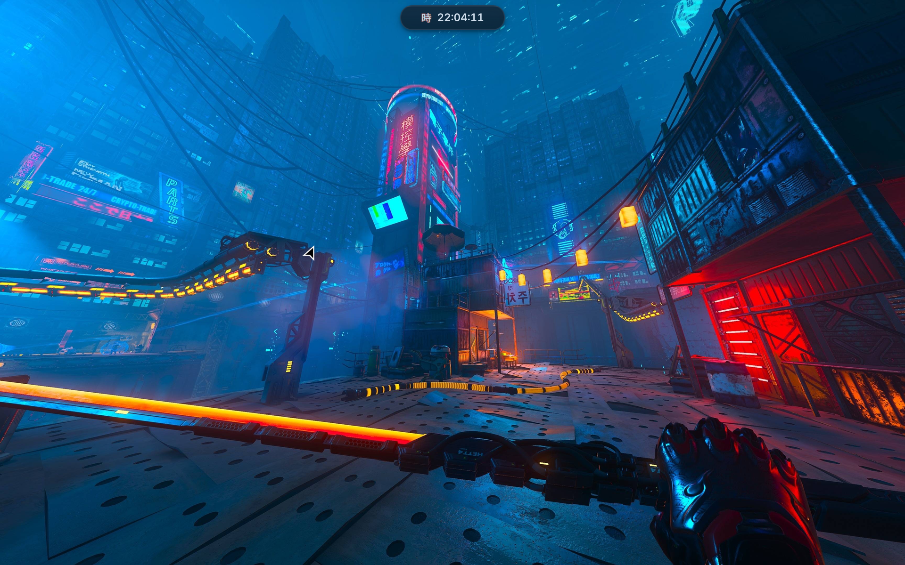

# Lumen

**A Hyprland desktop on Arch Linux, built around a single morphing "pill" written in Quickshell.**



The whole desktop lives in one pill at the top of the screen. At rest it's a
clock; hover it for an icon row; click an icon and the pill morphs into that
page. Everything recolours itself from your wallpaper.

| At rest | On hover |
|---|---|
|  |  |

A personal fork of [Ricelin](https://github.com/Gakuseei/Ricelin), with my own
pages, fixes and styling on top.

> [!IMPORTANT]
> **These are my personal dotfiles, tuned for my own laptop**: an Intel Core
> Ultra 7 155H (Meteor Lake) with Intel Arc integrated graphics and 16 GB of
> RAM. Most of Lumen works on any Arch + Hyprland machine, but some parts are
> set up specifically for this hardware: above all **dictation**, whose fast
> path runs on the Intel GPU. On an **NVIDIA** or **AMD** GPU, or a different
> CPU, expect to adjust a few things to get the best out of it. See
> [Dictation on other hardware](#dictation-on-other-hardware). Monitor layout,
> keybinds and app choices are mine too; change them freely.

## Contents

- [Features](#features)
- [Installation](#installation)
- [Optional extras](#optional-extras)
- [Dictation](#dictation)
- [Dictation on other hardware](#dictation-on-other-hardware)
- [Keybinds](#keybinds)
- [The `lumen` command](#the-lumen-command)
- [Troubleshooting](#troubleshooting)
- [Credits](#credits)

## Features

- **Pages:** launcher, clipboard, emoji, mixer, sound (EQ, AutoEQ, per-app volume), media, calendar with weather, clock (stopwatch, timer, world clock), keep awake, recorder, system monitor, Wi-Fi, Bluetooth, battery, power, wallpaper picker, settings
- **Colours from your wallpaper** for the pill, Hyprland, lock screen, kitty, fish, starship, Spotify and (optionally) GTK apps
- **Frosted glass** GTK and Zen Browser styling
- **Dictation:** hold Right Alt, talk, let go, and your words appear in whatever app has focus. Fully offline (Whisper on the GPU), transcribes while you're still talking so even long takes finish about a second after you let go, understands voice commands for lists, quotes, brackets and lettered parts, learns how you say names, and has its own tray icon
- **Keyboard first:** every page works with the arrow keys, Enter and Esc

**Stack:** Hyprland (Lua) · Quickshell · kitty + fish + starship · PipeWire · awww + mpvpaper · hyprlock + hypridle

## Installation

You'll need Arch Linux with a `sudo` user and an AUR helper (paru or yay).
Keep **bash** as your login shell; kitty runs fish for you.

**1. Get the files**

```sh
git clone https://github.com/aprameyansr/Lumen.git ~/lumen
cd ~/lumen
```

**2. Back up** anything in `~/.config` you want to keep.

**3. Install the packages** from [`packages.txt`](packages.txt). Remove any apps
you don't want first, and swap `vulkan-intel` for your GPU's Vulkan driver if
you're not on Intel (`vulkan-radeon` for AMD, `nvidia-utils` for NVIDIA):

```sh
paru -S --needed $(grep -vE '^\s*(#|$)' packages.txt | awk '{print $1}')
```

**4. Copy the configs**

```sh
cp -a .config/. ~/.config/
mkdir -p ~/.local/bin && cp -a .local/bin/. ~/.local/bin/
mkdir -p ~/.local/share && cp -a .local/share/. ~/.local/share/
chmod +x ~/.local/bin/* ~/.config/hypr/scripts/*.sh
xdg-user-dirs-update
```

**5. Enable the services**

```sh
sudo systemctl enable --now NetworkManager bluetooth
systemctl --user enable --now pipewire pipewire-pulse wireplumber
systemctl --user enable hypridle hyprsunset hyprpolkitagent
```

**6. Boot straight into Hyprland** (no display manager). Auto-login on tty1:

```sh
sudo systemctl edit getty@tty1.service
```

```ini
[Service]
ExecStart=
ExecStart=-/sbin/agetty --skip-login --nonewline --noissue --autologin yourname --noreset --noclear - ${TERM}
```

Then start Hyprland on that login by adding this to the end of `/etc/bash.bashrc`:

```sh
#Start Hyprland automatically on TTY1
if [[ "$(tty)" == "/dev/tty1" ]]; then
	exec start-hyprland >/dev/null 2>&1
fi
```

The lock screen still asks for your password on every boot.

**7. Monitor:** `~/.config/hypr/modules/monitors.lua` is set up for my screen.
Edit it to match yours (`hyprctl monitors` lists them).

**8. Cursor:** download a cursor theme you like (e.g.
[Bibata](https://github.com/ful1e5/Bibata_Cursor/releases)), extract it into
`~/.local/share/icons`, and pick it in **Settings → Input → Cursor**. Set the
same name as `gtk-cursor-theme-name` in `~/.config/gtk-3.0/settings.ini` and
`~/.config/gtk-4.0/settings.ini`.

**9. Wallpapers:** none are included. Download some and put them in
`~/Pictures/Wallpapers` (videos work too).

**10. Reboot.** Log in at the lock screen, press **Super + C** and pick a
wallpaper.

## Optional extras

### Dictation setup

Offline speech-to-text: about 2 GB of disk, and about 2–3 GB of RAM while the
model is loaded (it unloads itself after 10 minutes unused). One script sets up
everything it needs. How to use it is under [Dictation](#dictation) below.

1. **Packages.** `packages.txt` already lists what it needs (`python`,
   `pipewire-audio`, `wtype`, `wl-clipboard`, `libpulse`, `cava`, `zenity`,
   `shaderc`, `vulkan-icd-loader`, and a Vulkan driver; see step 3 of the
   installation). With no working GPU driver, dictation still runs on the CPU
   engine.
2. **Files.** Step 4 above already copied the service to
   `~/.local/share/lumen-dictate` (`dictated.py` and `setup.sh`).
3. **Run the setup** (no root needed):

   ```sh
   sh ~/.local/share/lumen-dictate/setup.sh
   ```

   It does everything dictation needs: a Python runtime (including the tray
   icon's D-Bus library), both speech models (Whisper large-v3 for the GPU and
   Parakeet for the CPU), a Whisper build for your GPU with Vulkan, the word
   list and the tray icons. The build takes a few minutes and runs fewer jobs
   when you're low on free memory, so it won't freeze the machine. It's safe to
   run again: finished steps are skipped, and your vocabulary and history are
   never touched. If your GPU driver is missing it skips Whisper, says so, and
   you can re-run it after installing the driver.
4. **Turn it on** in **Settings → Dictation**, leave **Engine** on
   **Whisper**, then hold **Right Alt** and talk.

**Switching Whisper models:** the service loads `models/Whisper Large.bin`,
which the setup points at large-v3 (the most accurate on my voice). To use
another whisper.cpp model, download it into `models/` and re-point the link,
e.g. `ln -sf ggml-large-v3-turbo-q8_0.bin "Whisper Large.bin"`; the setup
never overwrites a link you've set.

**Moving to a new machine:** in **Settings → Dictation → Vocabulary**, use
**Export** first and **Import** on the new one. Your vocabulary and history
are never copied into the dotfiles.

**Rebuild Whisper** (after a GPU or driver change):
`rm -rf ~/.local/share/lumen-dictate/whisper && sh ~/.local/share/lumen-dictate/setup.sh`

**Remove dictation completely:** `rm -rf ~/.local/share/lumen-dictate`

### GTK glass

```sh
gsettings set org.gnome.desktop.interface gtk-theme adw-gtk3-dark
gsettings set org.gnome.desktop.interface color-scheme prefer-dark
```

Turn on **Settings → Appearance → App theme** to tint GTK apps from your wallpaper.

### Zen Browser

Copy the styling into your profile folder (see `about:profiles`):

```sh
cp ".config/zen/<profile>/user.js" ~/.config/zen/<your-profile>/
mkdir -p ~/.config/zen/<your-profile>/chrome && cp ".config/zen/<profile>/chrome/"* ~/.config/zen/<your-profile>/chrome/
```

Glass tooltips (needs root, kept across Zen updates by a pacman hook):

```sh
sudo install -Dm644 etc/zen-autoconfig/autoconfig.js etc/zen-autoconfig/mozilla.cfg -t /etc/zen-autoconfig/
sudo install -Dm644 etc/pacman.d/hooks/zen-autoconfig.hook /etc/pacman.d/hooks/zen-autoconfig.hook
sudo install -Dm644 /etc/zen-autoconfig/autoconfig.js /opt/zen-browser-bin/defaults/pref/autoconfig.js
sudo install -Dm644 /etc/zen-autoconfig/mozilla.cfg /opt/zen-browser-bin/mozilla.cfg
```

### Spotify

Install `spicetify-cli`, open Spotify once, then:

```sh
sudo chmod a+wr /opt/spotify /opt/spotify/Apps -R
spicetify backup apply
```

Set `prefs_path` in `~/.config/spicetify/config-xpui.ini` to your own home folder first.

### Weather

Click the town name in the calendar to set your location.

## Dictation

Hold **Right Alt** and talk. The clock in the pill turns into live mic bars,
then a small spinner when you let go, and the text is pasted into the focused
app and copied to the clipboard. **Tap Right Alt twice** to lock it on so you
can let go, and tap once more to finish.

Everything runs on your machine; nothing is sent anywhere.

**How it stays fast**

- **Transcribes while you talk.** Once a take passes about 4 seconds, each
  stretch up to a natural pause is transcribed in the background, with the
  text before it as context. When you let go, only the last few seconds are
  left, so a 30-second take finishes about as quickly as a short one.
- **Pastes instead of typing** letter by letter, so long text appears at once
  (Ctrl+V, or Ctrl+Shift+V in terminals).
- **Loads on demand.** The model stays in memory while you use it and unloads
  after 10 minutes unused. Pressing Right Alt reloads it in about 3 seconds
  while you start speaking.

On my laptop (Intel Arc, see [below](#dictation-on-other-hardware)) a short
phrase lands about 0.8 s after letting go, and long takes about 1 s.

**Engines** (Settings → Dictation → Engine):

| Engine | Runs on | Best for |
|---|---|---|
| **Whisper** large-v3 via [whisper.cpp](https://github.com/ggml-org/whisper.cpp) (default) | GPU | accuracy, fast or accented speech, names from your Vocabulary |
| **Parakeet** TDT 0.6B v2 via [sherpa-onnx](https://github.com/k2-fsa/sherpa-onnx) | CPU | machines without a working GPU driver |

If Whisper can't start, dictation falls back to Parakeet and sends a
notification saying why.

**Voice commands**

| Say | Get |
|---|---|
| "List: milk, eggs and bread" | a bullet list |
| "Numbered list: …" | 1. 2. 3. |
| "… end list" | ends the list, carries on below it |
| "open quote … close quote" | "…" |
| "He said quote I am him" | He said "I am him" (to the pause, or "unquote") |
| "open bracket … close bracket" | (…) |
| "internal assessment, bracket, CIA, …" | internal assessment (CIA), … (to the pause) |
| "A, construct… B, convert…" | parts on their own lines: A. Construct… / B. Convert… (letters said in order from A) |
| "new line" / "new paragraph" | line breaks |

Everyday uses stay as spoken: "tax bracket", "a metal bracket", "Plan A, then
plan B", "Vitamin A". Line breaks never press Enter, so a list dictated into a
chat box doesn't send the message early.

**Tray icon.** While dictation is on, a microphone sits in the tray (with a
slash through it when the model is unloaded). Its menu shows which engine is
running and lets you **unload the model now** to free the RAM before
something heavy (or load it again), **keep the model loaded** to pause the
10-minute unload, or **turn dictation off**.

**Settings → Dictation** has the on/off switch, your word count (today, all
time, and roughly how much typing it saved) and a history of everything you've
dictated: Enter copies an entry, Delete removes it.

**Vocabulary** (inside that page) teaches it names and terms it gets wrong:
add the word, say it three times, and from then on the ways it mishears it are
swapped for your spelling. Your words are also given to Whisper as hints, so
it tends to spell them right in the first place. Mishearings that are everyday
English (say, "April" for a name) are flagged and skipped so normal sentences
stay as spoken. Import and Export carry your list to another machine as a
JSON file.

Your vocabulary and history stay in `~/.local/share/lumen-dictate` and are
never copied into the dotfiles by `lumen sync`. The dictation key can be changed
in **Settings → Keybinds**.

## Dictation on other hardware

Dictation is the part most tied to my machine. Here's what it does on mine,
and what to change on yours.

**Intel Arc / Intel iGPU (my setup).** `setup.sh` builds whisper.cpp with
Vulkan, which works out of the box. On top of that I run an extra speed-up
that **isn't automated in this repo yet**: a whisper.cpp build with Intel
OpenVINO (`whisper/whisper-server-ov`), where Whisper's encoder runs through
OpenVINO on the Arc GPU (about 30% faster on short phrases), plus a small patch
so whisper.cpp skips its own unused copy of the encoder (about 0.5 GB less
RAM). `dictated.py` uses that build only if its files exist, and otherwise
falls back to the plain Vulkan build automatically, so nothing breaks without
it.

**AMD.** Install `vulkan-radeon` and the Vulkan build works as is. For more
speed you can build whisper.cpp with ROCm instead (`-DGGML_HIP=ON`, needs the
ROCm packages): change the `cmake` line in `setup.sh` and rebuild. The
OpenVINO speed-up is Intel-only and simply isn't used.

**NVIDIA.** Install `nvidia-utils` and the Vulkan build works. For the best
speed, build whisper.cpp with CUDA instead (`-DGGML_CUDA=ON`, needs `cuda`):
change the `cmake` line in `setup.sh` and rebuild. A dedicated NVIDIA GPU will
be much faster than my integrated one, and has its own video memory, so
keeping the model loaded costs no system RAM. You may want to raise or remove
the 10-minute unload (`IDLE` in `dictated.py`).

**No usable GPU.** Pick **Parakeet** in Settings: it runs on the CPU and needs
no GPU at all.

**Other things you may want to change** (all in `dictated.py`):

- `WHISPER_MODEL`: which model file to load (or just re-point the `Whisper Large.bin` link, see [Dictation setup](#dictation-setup))
- `IDLE`: seconds before an unused model unloads (`600`; `float("inf")` keeps it loaded)
- `Streamer.MIN_SEG` / `PAUSE` / `MAX_SEG`: when long takes are split into pieces while you talk
- the hint text in `Whisper.prompt()`: example sentences that teach Whisper your punctuation and spoken commands

## Keybinds

| Keys | Action | Keys | Action |
|---|---|---|---|
| `Super + Space` | Launcher | `Super + Q` | Close window |
| `Super + V` | Clipboard | `Super + F` | Toggle floating |
| `Super + .` | Emoji | `Super + D` | Maximize |
| `Super + C` | Wallpaper picker | `Super + Shift + D` | Fullscreen |
| `Super + B` | Random wallpaper | `Super + J` | Toggle split |
| `Super + U` | Mixer | `Alt + Tab` | Cycle windows |
| `Super + A` | Network | `Super + 1` … `0` | Workspace 1 … 10 |
| `Super + I` | Settings | `Super + Ctrl + 1` … `0` | Send window to workspace |
| `Super + R` | Screen recorder | `Super + Left / Right` | Previous / next workspace |
| `Super + X` | Power menu | `Super + P` / `Super + S` | Private / stash workspace |
| `Super + H` | Do Not Disturb | `Super + L` | Lock |
| `Super + Return` | Terminal | `Super + W` | Browser |
| `Super + E` | Files | `Super + N` | Obsidian |
| `Super + M` | Spotify | `Ctrl + Shift + Esc` | Task manager |
| `Print` | Screenshot | `Super + Shift + C` | Colour picker |
| `Right Alt` (hold) | Dictate | `Right Alt` × 2 | Lock dictation on |

Change them in `~/.config/hypr/modules/binds.lua` or **Settings → Keybinds**.

## The `lumen` command

| Command         | Does                                                |
| --------------- | --------------------------------------------------- |
| `lumen status`  | Is the pill running                                 |
| `lumen restart` | Restart the pill                                    |
| `lumen log`     | Follow the pill's log                               |
| `lumen sync`    | Copy your live configs back into `~/lumen` (dictation: code only, never your vocabulary or history) |

To update: `git pull` in `~/lumen`, copy the configs again (step 4) and
`lumen restart`.

## Troubleshooting

- **Boots to a TTY:** check the getty override and the `/etc/bash.bashrc` block, and that your login shell is bash.
- **No pill:** `lumen log` shows the error.
- **No sound:** install `sof-firmware` (Intel laptops) and reboot.
- **Kanji show as boxes:** install `ttf-zen-kakugothic-new` and run `fc-cache -f`.
- **Chinese/Korean text shows as boxes:** install `noto-fonts-cjk`.
- **GUI apps never ask for a password:** `systemctl --user enable --now hyprpolkitagent`.
- **Right Alt does nothing:** run the dictation setup above, check **Settings → Dictation** is on, and `lumen log` for errors.
- **"Whisper couldn't start" notification:** dictation switched to Parakeet. "isn't installed" means the setup didn't finish, so run it again; "the GPU driver may be missing" means install your GPU's Vulkan driver, then rebuild Whisper. If the build itself failed, the reason is in `~/.local/share/lumen-dictate/.build/build.log`.
- **Dictation types the wrong words:** teach names under **Vocabulary**; those words also become hints for Whisper. If your GPU can't run Whisper well, try Parakeet.
- **Dictation uses too much RAM:** unload the model from its tray icon, or lower `IDLE` in `dictated.py`.

## Credits

Built on [Ricelin](https://github.com/Gakuseei/Ricelin) by Gakuseei. Licensed under [LICENSE](LICENSE).
